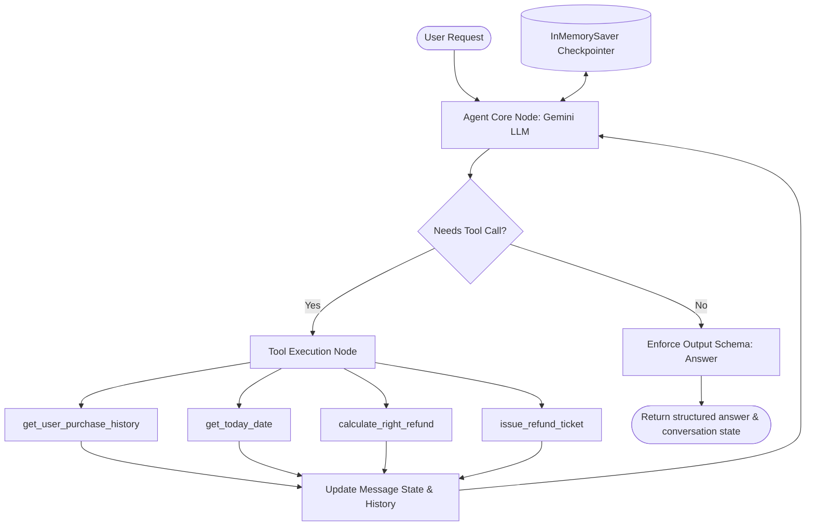
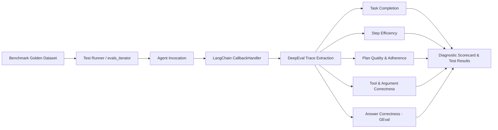

# 🤖 AI Agent Evaluation System

A production-grade architecture for **building**, **tracing**, and **rigorously evaluating** autonomous AI agents. This repository features a real-world customer support and refund policy agent built with **LangChain**, **LangGraph**, and **Google Gemini**, backed by a full evaluation suite powered by **DeepEval**.

---

## 📌 Table of Contents
1. [Overview](#-overview)
2. [System Architecture](#-system-architecture)
3. [Repository Structure](#-repository-structure)
4. [How the Agent Works](#-how-the-agent-works)
   - [Conversational State & Memory](#conversational-state--memory)
   - [Tool Arsenal & Business Rules](#tool-arsenal--business-rules)
   - [Structured Response Schema](#structured-response-schema)
5. [Evaluation Methodology & Techniques](#-evaluation-methodology--techniques)
   - [Agentic Evaluation vs. Standard LLM Evaluation](#agentic-evaluation-vs-standard-llm-evaluation)
   - [The 7 Core Agent Evaluation Metrics](#the-7-core-agent-evaluation-metrics)
   - [Golden Benchmark Dataset](#golden-benchmark-dataset)
   - [Evaluation Metrics Comparison](#evaluation-metrics-comparison)
6. [Installation & Setup](#-installation--setup)
7. [Running the System](#-running-the-system)
   - [Running the Interactive Agent](#1-running-the-interactive-agent)
   - [Running the Comprehensive Evaluation Suite](#2-running-the-comprehensive-evaluation-suite)
   - [Running Individual Metric Evaluations](#3-running-individual-metric-evaluations)
8. [Agent Implementation Details & Fixes](#-agent-implementation-details--fixes)
9. [Best Practices for AI Agent Evaluation](#-best-practices-for-ai-agent-evaluation)

---

## 🚀 Overview

Unlike single-prompt LLM applications or standard question-answering systems, **autonomous AI agents** plan, reason, invoke external tools, maintain conversational memory, and adapt to non-deterministic environments. Evaluating these systems requires more than simple text similarity—it demands **trajectory analysis**, **tool-calling verification**, **plan adherence checks**, and **multi-turn goal completion scoring**.

This project provides an end-to-end blueprint demonstrating:
- **Agent Construction**: Reactive tool-calling agent using `langchain.agents.create_agent`, Google Gemini 2.5/Flash, and LangGraph checkpointer memory.
- **Agent Tracing**: Capturing detailed execution traces (intermediate steps, LLM thoughts, tool calls, and inputs/outputs) via `CallbackHandler`.
- **Systematic Evaluation**: Measuring 7 distinct quantitative dimensions of agent performance using **DeepEval**.

---

## 🏗 System Architecture

### 1. Agent Execution Flow


### 2. Evaluation Pipeline


---

## 📂 Repository Structure

```plaintext
AI Agent Evalution/
├── agent/                         # Core Agent Implementation
│   ├── agent.py                   # Agent definition, checkpointer, and conversation loop
│   ├── models.py                  # Gemini LLM configuration (ChatGoogleGenerativeAI)
│   ├── tools.py                   # Tool definitions: history, date, refund calc, ticket issue
│   ├── objects.py                 # Pydantic schemas (Answer, PurchaseItem)
│   ├── prompts.py                 # System prompt & strict business guidelines
│   └── data.py                    # Mock database of user purchases and dates
│
├── evaluations/                   # DeepEval Evaluation Suite
│   ├── dataset.py                 # Golden benchmark test cases (happy path & edge cases)
│   ├── model.py                   # Evaluation judge model configuration
│   ├── eval_all.py                # Unified runner testing all 7 metrics concurrently
│   ├── task_completion.py         # Evaluates end-to-end goal achievement
│   ├── tool_correctness.py        # Evaluates tool selection accuracy
│   ├── argument_correctness.py    # Evaluates tool argument/parameter precision
│   ├── answer_correctness.py      # Evaluates final semantic and logical output
│   ├── step_efficiency.py         # Evaluates trajectory conciseness and loops
│   ├── plan_quality.py            # Evaluates logical reasoning and task breakdown
│   └── plan_adherence.py          # Evaluates adherence to the agent's plan
│
├── .env                           # Environment secrets (GOOGLE_API_KEY, GOOGLE_MODEL)
├── .env.example                   # Example environment file template
├── pyproject.toml                 # Project metadata & dependencies
└── README.md                      # Comprehensive project documentation
```

---

## ⚙️ How the Agent Works

The agent acts as an automated **Customer Support Refund Specialist**. Its purpose is to handle user refund requests while strictly enforcing company policy.

### Conversational State & Memory
- Built on top of **LangGraph's compiled state graph**.
- Utilizes `InMemorySaver()` as a checkpointer. Every user session is assigned a unique `thread_id` via `uuid4()`, preserving message history across multiple turns without leaking context between different users.

### Tool Arsenal & Business Rules

| Tool | Purpose | Signature |
| :--- | :--- | :--- |
| `get_user_purchase_history` | Retrieves customer purchase records from mock database | `(user: str) -> dict` |
| `get_today_date` | Returns current system date (`YYYY-MM-DD`) | `() -> str` |
| `calculate_right_refund` | Computes eligible refund amount for specific items | `(user: str, items: list) -> str` |
| `issue_refund_ticket` | Creates an official refund transaction ticket | `(user: str, refund_amount: int) -> str` |

#### Mandatory Business Rules Enforced by Prompt:
1. **30-Day Window**: No refund can be granted for purchases made more than 30 days prior to today's date.
2. **Identity Verification**: The customer username must exist in the database. If not found, the agent must ask for a valid username and refuse to proceed with refund processing.
3. **Item Scoping**: Only refund the specific items explicitly requested by the user, even if their order contained other items.
4. **Purchase Verification**: Refunds can only be granted for items actually purchased by the user.
5. **Ticket Issuance Requirement**: If eligible, the agent must invoke `issue_refund_ticket` before communicating success. If ineligible, the agent must explain the specific reason (e.g., past 30 days, item not purchased).
6. **Information-Only Inquiries**: If a user asks what they purchased, provide the purchase details without issuing any refund tickets.

### Structured Response Schema
The agent yields responses formatted according to the `Answer` Pydantic model (`objects.py`):
```python
class Answer(BaseModel):
    answer: str = Field(
        description="The customer-facing answer addressing the user's question or status."
    )
    conversation: bool = Field(
        description="False if the agent has made a final decision on the refund; True if more information is required.",
        default=True
    )
```
This guarantees structured output and enables downstream workflows to determine whether the dialogue should continue or close.

---

## 🔬 Evaluation Methodology & Techniques

### Agentic Evaluation vs. Standard LLM Evaluation

| Attribute | Standard LLM / RAG Evaluation | Agentic Evaluation (This System) |
| :--- | :--- | :--- |
| **Primary Focus** | Input $\to$ Output text similarity | Multi-step reasoning, action trajectory, tool use |
| **Execution Path** | Single inference step | Dynamic, multi-step loops with feedback loops |
| **Failure Modes** | Hallucinations, factual inaccuracy | Infinite loops, wrong tool selection, bad arguments, policy violations |
| **Measurement** | Lexical overlap (BLEU/ROUGE), Ragas RAG triad | DeepEval Agentic Metrics (Trace-based + G-Eval) |

---

### The 7 Core Agent Evaluation Metrics

This project implements a complete evaluation battery across **Trace-Level** and **Single-Turn** metrics:

```plaintext
┌────────────────────────────────────────────────────────────────────────┐
│                        AGENT EVALUATION SUITE                          │
├──────────────────────────────────┬─────────────────────────────────────┤
│       TRACE-LEVEL METRICS        │         SINGLE-TURN METRICS         │
│  (Analyzes step-by-step trace)   │     (Input / Output verification)   │
├──────────────────────────────────┼─────────────────────────────────────┤
│ 1. Task Completion               │ 5. Tool Selection Correctness       │
│ 2. Step Efficiency               │ 6. Tool Argument Correctness        │
│ 3. Plan Quality                  │ 7. Answer Correctness (G-Eval)      │
│ 4. Plan Adherence                │                                     │
└──────────────────────────────────┴─────────────────────────────────────┘
```

#### 1. Task Completion (`TaskCompletionMetric`)
- **What it measures**: Evaluates whether the agent successfully achieved the user's objective according to a defined task specification (`SUCCESSFUL_TASK_DESCRIPTION`).
- **How it works**: An LLM judge inspects the entire LangChain callback trace (user prompt, tool call outputs, agent intermediate thoughts, and final response).
- **Threshold**: `0.8`
- **Why it matters**: Catches cases where the agent replied politely but failed to execute the refund, or issued a ticket when it was prohibited by policy.

#### 2. Tool Selection Correctness (`ToolCorrectnessMetric`)
- **What it measures**: Determines whether the agent called the exact tools expected for a given scenario, penalizing both missing tools (false negatives) and extraneous tool calls (false positives).
- **How it works**: Compares `tools_called` in the execution trace against `expected_tools` defined in the benchmark dataset.
- **Threshold**: `0.9`
- **Why it matters**: Prevents agents from skipping critical validation steps (e.g., checking order history or checking current date before issuing money).

#### 3. Tool Argument Correctness (`ArgumentCorrectnessMetric`)
- **What it measures**: Verifies whether the arguments passed to each invoked tool matched the required schema and values.
- **How it works**: Compares argument dictionaries (e.g. `{"user": "user123", "refund_amount": 23}`) against ground truth.
- **Why it matters**: Ensures the agent does not refund incorrect monetary amounts or call tools on behalf of wrong user accounts.

#### 4. Semantic Answer Correctness (`GEval` - Custom Rubric)
- **What it measures**: Assesses whether the agent's final text output reaches the same logical and factual conclusion as the reference answer.
- **How it works**: Uses DeepEval's `GEval` with explicit criteria:
  > *"Check that the actual output and expected output have the same logical conclusion about the user's request."*
- **Threshold**: `0.8`
- **Why it matters**: Traditional string matching (exact match, BLEU) fails on LLM responses due to natural language variability. `GEval` evaluates semantic intent and business logic.

#### 5. Step Efficiency (`StepEfficiencyMetric`)
- **What it measures**: Evaluates the conciseness of the agent's trajectory, penalizing redundant actions, unnecessary tool re-invocations, and circular loops.
- **Threshold**: `0.8`
- **Why it matters**: Extra steps translate directly into added latency, token consumption, and financial cost.

#### 6. Plan Quality (`PlanQualityMetric`)
- **What it measures**: Assesses the soundness, logical progression, and safety of the sub-goals and actions formulated by the agent.
- **Threshold**: `0.8`
- **Why it matters**: Identifies flawed agent reasoning early, before erroneous actions are carried out.

#### 7. Plan Adherence (`PlanAdherenceMetric`)
- **What it measures**: Verifies whether the agent actually adhered to the plan it generated or deviated into unexpected behaviors.
- **Threshold**: `0.8`
- **Why it matters**: Crucial for high-stakes enterprise agents where predictability and auditability are required.

---

### Golden Benchmark Dataset

Located in [`evaluations/dataset.py`](file:///e:/Prateek/Projects/AI%20Agent%20Evalution/evaluations/dataset.py), the benchmark includes goldens specifically designed to stress-test agent behavior:

| Test Case | Scenario / Input | Expected Behavior | Required Tools |
| :--- | :--- | :--- | :--- |
| **Case 1: Full Refund** | `user123` requests refund for book ($23) & pen ($7) | Issues $30 ticket | `get_user_purchase_history`, `get_today_date`, `calculate_right_refund`, `issue_refund_ticket` |
| **Case 2: Single Item** | `user123` requests refund for book only | Issues $23 ticket | Same sequence, scoped strictly to book |
| **Case 3: Info Only** | `user123` asks what they bought, no refund | Lists items; **no refund ticket** | `get_user_purchase_history` only |
| **Case 4: Invalid User** | `user999` (non-existent) requests refund | Rejects request; asks for valid username | `get_user_purchase_history` only |
| **Case 5: Policy Expired** | `user126` requests water bottle (bought >30 days ago) | Denies refund due to 30-day window | `get_user_purchase_history`, `get_today_date` |
| **Case 6: Mixed Eligibility** | `user126` requests backpack (eligible) + water bottle (expired) | Partial refund ($45) for backpack only; explains water bottle denial | Full tool pipeline scoped strictly to eligible item |
| **Case 7: Unpurchased Item** | `user126` requests refund for sneakers (never bought) | Denies refund; explains item was never purchased | `get_user_purchase_history` only |

---

### Evaluation Metrics Comparison

| Metric | Level | Input Required | Primary Risk Mitigated |
| :--- | :--- | :--- | :--- |
| **Task Completion** | End-to-End | Trace + Task Description | Agent drops tasks or violates company policy |
| **Tool Correctness** | Tool-Level | Trace + Expected Tools | Agent skips verification or calls incorrect tools |
| **Argument Correctness**| Tool-Level | Tool Calls + Expected Args | Wrong refund values or misidentified users |
| **Step Efficiency** | Trajectory | Trace | Looping, redundant tool queries, token bloat |
| **Plan Quality** | Reasoning | Trace | Illogical or unsafe execution strategies |
| **Plan Adherence** | Execution | Trace | Plan drift / hallucinated diversions |
| **Answer Correctness** | Response | Input + Output + Expected | Inaccurate customer communication |

---

## 💻 Installation & Setup

### Prerequisites
- Python 3.13+
- A Google AI Studio API Key ([Get one here](https://aistudio.google.com/))

### 1. Clone & Enter Repository
```bash
git clone https://github.com/PrateekRocks/ai-agent-evalution-system.git
cd "AI Agent Evalution"
```

### 2. Configure Environment
Create a `.env` file in the project root:
```env
GOOGLE_API_KEY="your_actual_google_api_key_here"
GOOGLE_MODEL="gemini-2.5-flash"
```

### 3. Install Dependencies
Using `pip` with the virtual environment:
```bash
python -m venv .venv
# Windows:
.venv\Scripts\activate
# Linux/macOS:
source .venv/bin/activate

pip install -r <(uv pip compile pyproject.toml)
# Or direct install:
pip install langchain langchain-google-genai langgraph pydantic python-dotenv deepeval
```

---

## 🏃 Running the System

### 1. Running the Interactive Agent
To run an interactive conversation session in your terminal:
```bash
python agent/agent.py
```
**Example Session:**
```
I would like to request a refund
reply: 
I am user123 and I want to return the book.
2026-10-19 19:00:00 | INFO | using get_user_purchase_history tool on user: user123
2026-10-19 19:00:01 | INFO | using get_today_date
2026-10-19 19:00:01 | INFO | using calculate_right_refund tool to get user's: user123 refund
2026-10-19 19:00:02 | INFO | using issue_refund_ticket for user: user123
A refund ticket with the amount of $23 was issued and should be arriving soon to your bank account.
the job is done!
```

---

### 2. Running the Comprehensive Evaluation Suite
Run all 7 metrics concurrently against the complete golden benchmark dataset:
```bash
python evaluations/eval_all.py
```
This generates a detailed terminal scorecard displaying:
- Pass/Fail status for each golden test case
- Metric scores (0.0 to 1.0) against thresholds
- Reasoning provided by the evaluator LLM for any failures

---

### 3. Running Individual Metric Evaluations
You can also run isolated evaluations for targeted debugging:

```bash
# Test overall task completion & policy adherence
python evaluations/task_completion.py

# Test tool invocation accuracy
python evaluations/tool_correctness.py

# Test parameter & argument validity
python evaluations/argument_correctness.py

# Test semantic answer correctness
python evaluations/answer_correctness.py

# Test trajectory efficiency & loop avoidance
python evaluations/step_efficiency.py

# Test plan formation quality
python evaluations/plan_quality.py

# Test plan adherence
python evaluations/plan_adherence.py
```

---

## 🛠 Agent Implementation Details & Fixes

During code review of the base agent, several critical production fixes were identified:

1. **Package Imports**: Updated imports to use explicit package roots or relative imports so the agent can be cleanly imported across `evaluations/` and test runners without `ModuleNotFoundError`.
2. **Top-Level Execution Guard**: Wrapped `run_conversation()` in `if __name__ == "__main__":` to prevent scripts from blocking on `input()` during imports.
3. **Model Configuration**: Synced `models.py` with `os.getenv("GOOGLE_MODEL", "gemini-2.5-flash")` rather than hardcoded experimental names.
4. **Tool Name Synchronization**: Resolved discrepancy in `prompts.py` where the date tool was called `Check_current_date` instead of its declared identifier `get_today_date`.
5. **Flexible Tool Parameter Types**: Updated `calculate_right_refund` to accept both raw string lists and structured `PurchaseItem` objects to prevent Pydantic tool call validation crashes.
6. **Robust Output Parsing**: Added safe `.get("structured_response")` fallback handling in `agent.py` to prevent `AttributeError` if the model responds with unstructured text.

---

## 🏆 Best Practices for AI Agent Evaluation

1. **Evaluate Trajectories, Not Just Outputs**: An agent might guess the right answer by accident while executing completely incorrect tools or skipping validation steps. Always inspect the tool trace.
2. **Include Negative & Adversarial Test Cases**: At least 30-40% of your evaluation dataset should consist of unfulfillable requests, expired tickets, invalid user IDs, and malicious inputs to verify guardrails.
3. **Separate Agent Model from Judge Model**: Always use an independent model (or a higher-tier model like Gemini 1.5 Pro / GPT-4o) as the evaluator judge to prevent self-eval bias.
4. **Maintain Deterministic Tool Mocks**: Ensure data sources (such as `data.py`) produce deterministic outputs during evaluation runs to prevent test flakiness.
5. **Enforce CI/CD Regression Gates**: Run `evaluations/eval_all.py` on pull requests to ensure changes to system prompts, tools, or models do not degrade policy adherence or increase token consumption.

---

## 📄 License
This project is licensed under the MIT License.
